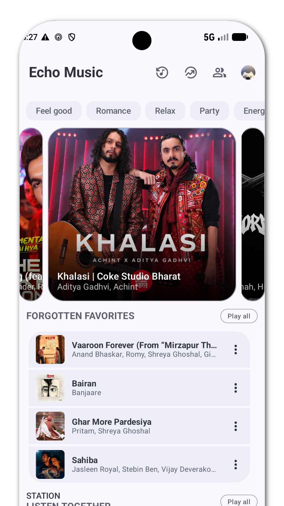
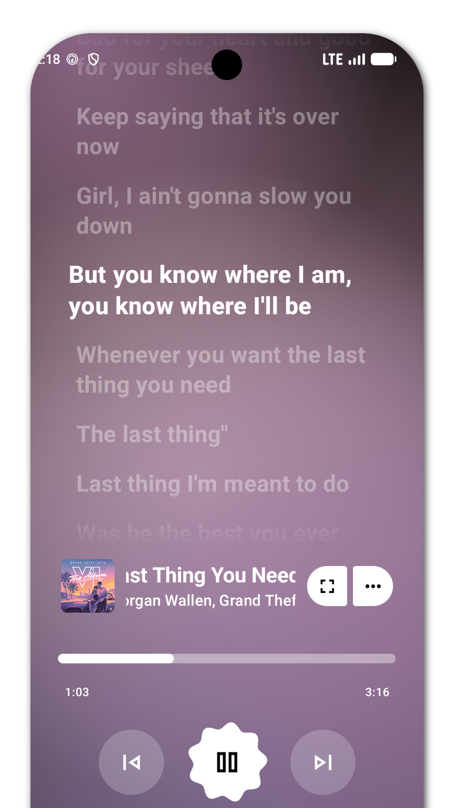
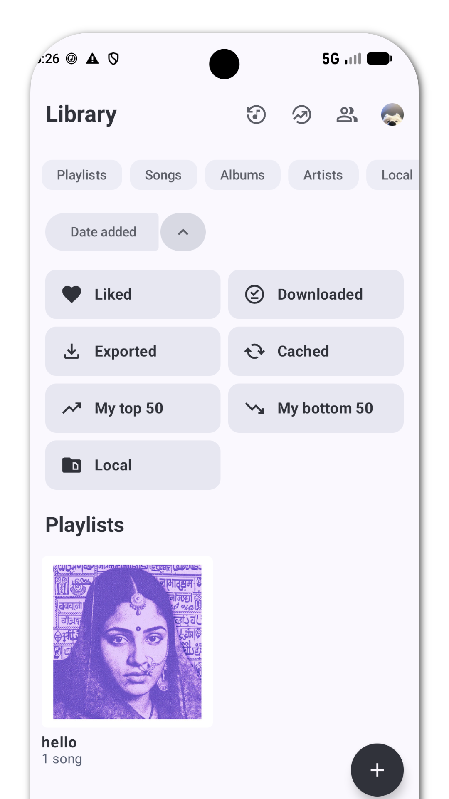

<div align="center">
  
  <h1>Tuneify</h1>
  <p><b>A modern, expressive Android music streaming client crafted with Liquid Glassmorphism, Material Expressive rhythms, and zero ads.</b></p>

  <p>
    <a href="https://github.com/VivxKumar07/Tuneify/releases/latest"></a>
    <a href="https://github.com/VivxKumar07/Tuneify"></a>
    <a href="LICENSE"></a>
    <a href="https://github.com/VivxKumar07/Tuneify/stargazers"></a>
  </p>
</div>

---

## 🎵 What is Tuneify?

**Tuneify** is an expressive, privacy-first Android music application built with modern **Jetpack Compose**. It blends the vast music catalog of YouTube Music with an organic **Liquid Glassmorphism** visual identity and fluid **Material Expressive** UI rhythms.

Designed for music lovers who appreciate clean aesthetics, rich audio fidelity, and effortless navigation:
- 🌿 **Liquid Glass Visual Language**: Frosted translucent layers, ambient aura lighting, and organic stadium shapes.
- 🎨 **Adaptive Artwork Palette**: Dynamic ambient color extraction that tints the entire application canvas in real time to match the playing song.
- 📐 **YouTube Music Layout Rhythms**: Engaging visual variety featuring 4-track stack columns, compact Speed Dial tiles, square album carousels, and rich community playlist cards.
- 👆 **Intuitive Gestures**: Swipe right-to-left across the album cover to instantly unveil word-by-word synchronized lyrics; swipe back effortlessly without colliding with system gestures.
- ⚡ **Seamless Offline Listening**: Download your favorite tracks and full playlists directly from the player with real-time download status indicators.
- 🛡️ **Zero Tracking, Zero Ads**: No interruptions, no analytics tracking, no commercial subscriptions. 100% Free and Open Source.

---

## ✨ Features at a Glance

### 🎨 Visual & Expressive Design
- **Harmonic Dynamic Theming**: Album artwork colors are dynamically extracted and animated across backgrounds, glow orbs, bottom navigation, and media controls.
- **Tilted Pill Hero Spotlight**: Auto-advancing Material Expressive carousel highlighting curated albums and artist essentials with subtle organic tilt animations.
- **Organic Stadium Artwork Container**: Distinctive asymmetric rounded stadium artwork frame in the player that feels physical and tactile.
- **Floating Liquid Bottom Navbar**: Compact pill-shaped frosted glass bar with reflective glass highlighter and balanced touch targets.

### 🎧 Listening & Audio Engine
- **Bit-Perfect Playback**: High-fidelity audio rendering with Gapless Playback, Loudness Normalization, and Direct USB Audio (DAC) support.
- **Built-in Equalizer & DSP**: Fine-tune frequency bands or apply presets tailored to your headphones and sound setup.
- **Audio & Video Toggle**: Seamlessly switch between audio-only streams and music videos without losing your playback position.
- **Background & Sleep Timer**: Uninterrupted playback with the screen off or in other apps, with an customizable sleep timer.

### 📖 Lyrics & Discovery
- **Synchronized Lyrics**: Word-by-word scrolling lyrics synchronized to playback.
- **Gesture-driven Lyrics View**: Swipe right-to-left directly over the playing artwork to reveal lyrics; swipe back with a natural flick.
- **Fast Discovery**: Explore Top Charts, New Releases, Moods & Genres, and Community Playlists.
- **Smart Queue & Radio**: Generate endless continuous radio queues based on any track, artist, or playlist.

---

## 📸 Screenshots

<div align="center">
  <table style="margin: 0 auto; border-collapse: collapse;">
    <tr>
      <td align="center" style="padding: 12px;">
        <b>Home Screen & Hero Carousel</b><br><br>
        
      </td>
      <td align="center" style="padding: 12px;">
        <b>Liquid Glass Player</b><br><br>
        
      </td>
      <td align="center" style="padding: 12px;">
        <b>Synchronized Lyrics</b><br><br>
        
      </td>
    </tr>
    <tr>
      <td align="center" style="padding: 12px;">
        <b>Search & Quick Picks</b><br><br>
        
      </td>
      <td align="center" style="padding: 12px;">
        <b>Music Library & Playlists</b><br><br>
        
      </td>
      <td align="center" style="padding: 12px;">
        <b>Apple Style Glass Player</b><br><br>
        
      </td>
    </tr>
  </table>
</div>

---

## 🚀 Installation

### 1. Download Pre-built APK
Get the official release from the [GitHub Releases](https://github.com/VivxKumar07/Tuneify/releases/latest) page:
- **`app-universal-gms-debug.apk`** — Recommended for all standard Android devices with Google Play Services.
- **`app-universal-foss-debug.apk`** — For de-googled devices (MicroG / GrapheneOS / CalyxOS).

### 2. Building from Source
Ensure you have the following installed:
- Android Studio Hedgehog (or later) / JDK 17+
- Android SDK 35 (Android 15) & NDK (for USB audio native modules)

Clone the repository and build using Gradle:
```bash
# Clone the repository
git clone https://github.com/VivxKumar07/Tuneify.git
cd Tuneify

# Build Universal GMS Debug APK
./gradlew :app:assembleUniversalGmsDebug

# Or build Universal FOSS Debug APK
./gradlew :app:assembleUniversalFossDebug
```
The compiled APK will be located in `app/build/outputs/apk/universalGms/debug/`.

---

## 🛠️ Architecture & Tech Stack

Tuneify is engineered following modern Android architecture best practices:
- **UI Framework**: 100% Jetpack Compose with custom hardware-accelerated RenderEffect shaders, PorterDuff blending, and Canvas rendering.
- **Media Engine**: AndroidX Media3 (ExoPlayer) with custom audio processors, caching pipeline, and background media session service.
- **Data & Storage**: Android Jetpack Room with SQLite for offline metadata, listening history, and local playlist management.
- **Networking**: OkHttp 4, Kotlinx Serialization, and custom YouTube InnerTube API extractors.
- **Image Pipeline**: Coil with customized disk & memory caching, crossfade animations, and Palette bitmap color analysis.
- **Concurrency**: Kotlin Coroutines & Reactive Flow (`StateFlow` / `SharedFlow`).

---

## 🤝 Credits & Acknowledgements

Tuneify is an independent open-source client that proudly stands upon the incredible work of the FOSS community:

- **[Echo Music](https://github.com/iad1tya/Echo-Music)** by **[@iad1tya](https://github.com/iad1tya)** — Heartfelt gratitude for the extraordinary foundation in YouTube Music integration, audio caching, and player architecture. Tuneify builds upon Echo Music with a bespoke Liquid Glassmorphism design system, Material Expressive layouts, and gesture workflows.
- **[InnerTube API](https://github.com)** — The extraction logic powering reliable stream queries and high-resolution album thumbnails.
- **[Metrolist](https://github.com/MetrolistGroup/Metrolist)** & **[Vivi Music](https://github.com/vivizzz007/vivi-music)** — Foundational references for music queuing and library management.
- **[Better Lyrics](https://better-lyrics.boidu.dev/)** & **[SimpMusic](https://github.com/maxrave-dev/SimpMusic)** — For synchronized lyrics parsing and rendering references.
- **[Music Recognizer](https://github.com/aleksey-saenko/MusicRecognizer)** — Audio fingerprinting and recognition components.
- **[BravePipe](https://github.com/bravepipeproject/BravePipe)** — Decryption handling and backup playback engine.

---

## ⚖️ Legal Disclaimer & Terms of Use

1. **100% Free, Open-Source & Non-Commercial**:
   Tuneify is an open-source hobby project distributed under the **GNU General Public License v3.0**. It is provided strictly for educational purposes and personal use. There are no advertisements, paid features, or in-app purchases.

2. **Custom Third-Party Client**:
   Tuneify acts strictly as a specialized client interface. It parses publicly available endpoints of YouTube and YouTube Music. The ad-free streaming experience is functionally equivalent to using a standard web browser with content filtering extensions.

3. **Support Content Creators**:
   We deeply value artists and content creators. We encourage all users who enjoy music to subscribe to [YouTube Premium](https://www.youtube.com/premium) to financially support the artists and creators you love.

4. **No Hosting of Copyrighted Content**:
   Tuneify does not host, store, or distribute any media files on its own servers. All audio streams and artwork are fetched directly from Google/YouTube content servers and remain the property of their respective copyright holders.

---

<div align="center">
  <p>Released with ❤️ under the <a href="LICENSE">GNU General Public License v3.0</a></p>
  <p>Tuneify — Elevating your listening experience.</p>
</div>
